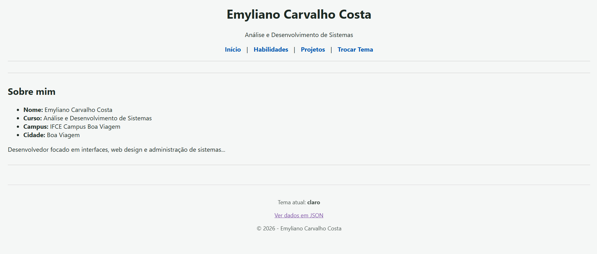
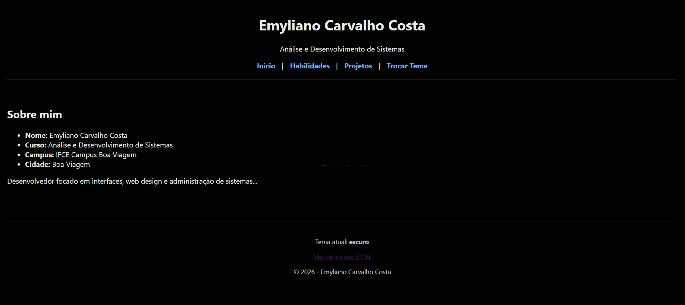

# Perfil do Estudante: versão 1

**Autor(a):** Emyliano Carvalho Costa

## Estrutura das Classes (Projeto Integrador v2)

**Classe `Projeto`**

| Visibilidade | Atributo / Método | Tipo / Retorno | 
| :--- | :--- | :--- | 
| `private` | `$titulo` | `string` | 
| `private` | `$descricao` | `string` | 
| `private` | `$tecnologias` | `string` | 
| `public` | `__construct(string $titulo, string $descricao, string $tecnologias)` | `-` | 
| `public` | `getTitulo()` | `string` | 
| `public` | `getDescricao()` | `string` | 
| `public` | `getTecnologias()` | `string` | 
| `public` | `paraArray()` | `array` | 

**Classe `Perfil`**

| Visibilidade | Atributo / Método | Tipo / Retorno | 
| :--- | :--- | :--- | 
| `private` | `$nome` | `string` | 
| `private` | `$curso` | `string` | 
| `private` | `$campus` | `string` | 
| `private` | `$cidade` | `string` | 
| `private` | `$apresentacao` | `string` | 
| `private` | `$habilidades` | `array` | 
| `private` | `$projetos` | `array` | 
| `public` | `__construct(string $nome, string $curso, string $campus, string $cidade, string $apresentacao, array $habilidades)` | `-` | 
| `public` | `adicionarProjeto(Projeto $projeto)` | `void` | 
| `public` | `getProjeto(int $id)` | `Projeto` | 
| `public` | `getNome()` | `string` | 
| `public` | `getCurso()` | `string` | 
| `public` | `getCampus()` | `string` | 
| `public` | `getCidade()` | `string` | 
| `public` | `getApresentacao()` | `string` | 
| `public` | `getHabilidades()` | `array` | 
| `public` | `getProjetos()` | `array` | 
| `public` | `paraArray()` | `array` | 

# Comparação de um trecho do V1 para o V2

**Trecho v1**

```
$perfil = [
    'nome' => 'Emyliano Carvalho Costa',
    'curso' => 'Análise e Desenvolvimento de Sistemas',
    'campus' => 'IFCE Campus Boa Viagem',
    'cidade' => 'Boa Viagem',
    'apresentacao' => 'Desenvolvedor focado em interfaces, web design e administração de sistemas...',
    'habilidades' => ['Figma', 'PHP', 'JavaScript', 'React', 'Linux']
];
```

**Trecho v2**

```
class Perfil
{
    private string $nome;
    private string $curso;
    private string $campus;
    private string $cidade;
    private string $apresentacao;
    private array $habilidades;
    private array $projetos = [];
}
```

## Como executar

```
cd projeto/v2
php -S localhost:8000 -d display_errors=1 -d output_buffering=0
```

Abra http://localhost:8000

## Telas

| Tema claro | Tema escuro |
|---|---|
|  |  |

## 1. Mapa de rotas

Complete com todas as rotas do seu projeto.

| URL | O que mostra | Status |
|---|---|---|
| `/` | Apresentação: nome, curso, campus, cidade e um texto sobre mim | 200 |
| `/?pagina=habilidades` | As minhas habilidades | 200 |
| `/?pagina=projetos` | Lista dos projetos com link para os detalhes | 200 |
| `/?pagina=projeto&id=1` | Detalhes do projeto 1: título, descrição e tecnologias | 200 |
| `/?pagina=projeto&id=99` | Mensagem "Projeto não encontrado" | 404 |
| `/?pagina=qualquercoisa` | Mensagem "Página não encontrada" | 404 |
| `/?tema=escuro` | A página com o tema escuro, gravado em cookie | 200 |
| `/?formato=json` | Todos os dados do perfil em formato JSON | 200 |

## 2. Saídas do terminal

**2.1 Uma página que existe:** `curl.exe -i "http://localhost:8000/?pagina=habilidades"` (cole só até o início do HTML)

```
HTTP/1.1 200 OK
Host: localhost:8000
Date: Thu, 29 Oct 2026 02:21:07 GMT
Connection: close
X-Powered-By: PHP/8.5.11
Content-type: text/html; charset=UTF-8


<!DOCTYPE html>
...
```

**Explicação:**

A requisição para a pagina deu certo, retornando a resposta 200 OK

**2.2 Uma página que não existe:** `curl.exe -i "http://localhost:8000/?pagina=projeto&id=99"` (cole só até o início do HTML)

```
HTTP/1.1 404 Not Found
Host: localhost:8000
Date: Thu, 29 Oct 2026 02:23:30 GMT
Connection: close
X-Powered-By: PHP/8.5.11
Content-type: text/html; charset=UTF-8

<!DOCTYPE html>
```

**Explicação:**

como não existe um projeto 99, o código entende que a página não existe e retorna o error 404 Not Found

**2.3 A troca de tema:** `curl.exe -i "http://localhost:8000/?tema=escuro"` (cole só até a linha do `<body>`)

```
HTTP/1.1 200 OK
Host: localhost:8000
Date: Thu, 29 Oct 2026 02:23:58 GMT
Connection: close
X-Powered-By: PHP/8.5.11
Set-Cookie: tema=escuro; expires=Sat, 28 Nov 2026 02:23:58 GMT; Max-Age=2592000
Content-type: text/html; charset=UTF-8

<!DOCTYPE html>
<html lang="pt-BR">
<head>
  <meta charset="UTF-8">
  <meta name="viewport" content="width=device-width, initial-scale=1">
  <title>Meu perfil</title>
  <link rel="stylesheet" href="estilo.css">
</head>
<body class="tema-escuro">
```

**Explicação (qual cabeçalho grava o tema e como o PHP sabe o tema na próxima requisição):**

Quem faz o trabalho de gravar o tema no navegador é o cabeçalho `Set-Cookie`. Próxma vez que a página for aberta, o próprio navegador tem a função de enviar de volta um cabeçalho chamado `Cookie`. Daí em diante, o PHP só precisa esperar a variável $_COOKIE['tema'] para se lembrar de qual foi o tema que escolhemos.

**2.4 A API:** `curl.exe -i "http://localhost:8000/?formato=json"`

```
{
    "nome": "Emyliano Carvalho Costa",
    "curso": "Análise e Desenvolvimento de Sistemas",
    "campus": "IFCE Campus Boa Viagem",
    "cidade": "Boa Viagem",
    "apresentacao": "Desenvolvedor focado em interfaces, web design e administração de sistemas...",
    "habilidades": [
        "Figma",
        "PHP",
        "JavaScript",
        "React",
        "Linux"
    ],
    "projetos": {
        "1": {
            "titulo": "IVolley",
            "descricao": "Sistema de gestão de treinos e rotações para a equipe de voleibol do IFCE.",
            "tecnologias": "PHP, HTML, CSS"
        },
        "2": {
            "titulo": "Observadores da Natureza",
            "descricao": "Plataforma web implementada e avaliada em ambiente escolar.",
            "tecnologias": "React, Docker, Figma"
        },
        "3": {
            "titulo": "Efeitos Visuais (VFX)",
            "descricao": "Desenvolvimento de scripts de efeitos visuais e animações para jogos.",
            "tecnologias": "Lua, Roblox Studio"
        }
    }
}
```

**Explicação:**

Aqui, é verifcado se na URL foi digitado o `?foramto=json`, depois que ele confirma o `header()` transforma todo o conteúdo no formato json, usando o `application/json`.

**2.5 Log do servidor** das quatro requisições acima

```
[Wed Oct 28 23:19:17 2026] [::1]:52229 Closing
[Wed Oct 28 23:20:13 2026] [::1]:57382 Accepted
[Wed Oct 28 23:20:13 2026] [::1]:57382 [200]: GET /?pagina=projeto&id=2
[Wed Oct 28 23:20:13 2026] [::1]:57382 Closing
[Wed Oct 28 23:21:07 2026] [::1]:54184 Accepted
[Wed Oct 28 23:21:07 2026] [::1]:54184 [200]: GET /?pagina=habilidades
[Wed Oct 28 23:21:07 2026] [::1]:54184 Closing
[Wed Oct 28 23:23:30 2026] [::1]:61234 Accepted
[Wed Oct 28 23:23:30 2026] [::1]:61234 [404]: GET /?pagina=projeto&id=99
[Wed Oct 28 23:23:30 2026] [::1]:61234 Closing
[Wed Oct 28 23:23:58 2026] [::1]:61240 Accepted
[Wed Oct 28 23:23:58 2026] [::1]:61240 [200]: GET /?tema=escuro
[Wed Oct 28 23:23:58 2026] [::1]:61240 Closing
[Wed Oct 28 23:24:46 2026] [::1]:61244 Accepted
[Wed Oct 28 23:24:46 2026] [::1]:61244 [200]: GET /?formato=json
[Wed Oct 28 23:24:46 2026] [::1]:61244 Closing

```

**Explicação:**

Este log mostra o servidor do PHP trabalhando em tempo real nos bastidores enquanto eu testo a minha aplicação. Cada conjunto de linhas representa um ciclo rápido e completo de comunicação entre o meu navegador (ou terminal) e o meu código.

## 3. Onde usei cada conceito

| Conceito | Linha(s) aproximada(s) do `index.php` | Para que usei |
|---|---|---|
| Array associativo | 8 a 34 | Usei para guardar os meus dados pessoais na variável `$perfil` e estruturar a minha lista de projetos na variável `$projetos`. |
| `$_GET` e `??` | 39 e 67 | Usei para capturar os parâmetros que vêm da URL (como `?pagina=` e `?tema=`) e definir valores padrão rapidamente caso eles não tenham sido enviados. |
| `if` / `elseif` / `else` | 41 a 45, e 101 a 146 | Usei para validar se o tema escolhido era válido e para decidir qual bloco de código HTML deveria ser renderizado dependendo da página acessada. |
| `htmlspecialchars` | 92 a 130 | Usei por segurança em todo o HTML, para converter caracteres especiais e garantir que os textos do meu perfil não quebrem o layout ou executem códigos maliciosos (XSS). |
| `setcookie` e `$_COOKIE` | 39 e 48 | Usei para ler a minha preferência de tema que estava salva no navegador e para gravar o novo cookie quando escolho trocar entre o tema claro e escuro. |
| `http_response_code(404)` | 74 e 78 | Usei para forçar o envio de um cabeçalho de "Não encontrado" (erro 404) caso eu tente acessar um ID de projeto inexistente ou uma rota inválida. |
| `header` e `json_encode` | 56 e 58 | Usei para alterar o tipo de resposta da página para `application/json` e transformar os meus arrays PHP num formato universal na rota da minha API. |
| `implode` e `count` | 113 e 114 | Usei para descobrir e exibir o número total das minhas habilidades, e depois para juntar todos os itens desse array numa única linha de texto separada por vírgulas. |

## 4. Decisões e dificuldades

**4.1 Por que toda a lógica PHP fica no topo do arquivo, antes do HTML?**

O PHP exige que essas instruções sejam processadas antes de qualquer conteúdo visual. Se eu colocasse qualquer pedaço de HTML antes delas, o PHP enviaria os cabeçalhos padrão automaticamente para o navegador, e as minhas funções iam falhar gerando o erro de "headers already sent".

**4.2 Por que o tema escolhido na URL precisa ser validado?**

Eu validei por segurança. Como o valor vai direto para a classe do `<body>` no HTML, sem essa verificação alguém poderia injetar códigos maliciosos na URL ou quebrar o visual do site. Forçando o sistema a aceitar estritamente "claro" ou "escuro", evito problemas e garanto que tudo funcione certinho.

**4.3 Qual foi a maior dificuldade e como você resolveu?**

A parte do `$this ->` ainda me pega bastante, mas com ajuda, da pra corrigir os erros